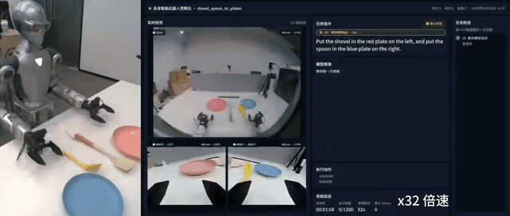

# Unitree R1-A7 GPT-6 控制

基于 [RoboICL](https://github.com/Mosi-AI/RoboICL) 的 GPT-6 Astra 视觉上下文学习策略，为 Unitree R1-A7 + Dex1 提供真机推理控制。策略读取头部与左右腕部相机画面及机器人状态，生成双臂末端动作；本地控制层负责逆运动学（IK）、动作连续性检查和 DDS 指令发布。

本仓库保留 GPT-6 推理所需的控制、相机输入和运行监视代码，不包含 VR 遥操作、示教采集工具、模型权重或 RoboICL 仿真训练环境。示教参考数据需在仓库外准备。

[Demo演示](#demo演示) · [控制闭环](#控制闭环) · [Rollout 指南](#rollout-指南) · [代码结构](#代码结构) · [运行入口](#运行入口) · [验证](#验证)

## Demo演示

展示 R1-A7 双臂将铲子和勺子放入对应盘子的真机演示：

<p align="center">
  
</p>

[查看完整分辨率 MP4 演示视频](docs/demo/demo.mp4)（约 23 秒）。

## 控制闭环

1. 从头部及左右腕部相机获取 RGB 图像，并从 DDS 状态读取双臂关节、夹爪状态；将观测和当前任务指令送入 RoboICL 策略。
2. GPT-6 Astra 根据最新观测提出一段受协议约束的末端动作；策略动作校验器检查动作结构和单步位移、旋转范围。
3. 本地环境将末端目标交给 Placo 求解 IK，并执行关节连续性检查；检查通过后经 Unitree DDS 发布双臂及夹爪命令。
4. 控制器读取动作后的新图像和机器人状态，更新策略观测后再规划下一段动作，直到达到步数上限、任务结束或操作员关闭监视界面。

策略提出的动作不等于已执行的动作；每次执行后都以实际机器人状态重新构造观测。动作连续性检查失败时会拒绝该目标，并通知策略基于原观测重新规划。

## Rollout 指南

本仓库使用 RoboICL 的单回合闭环，通过任务配置、可选协议配置和示教参考包控制 rollout：

- Zero-shot：省略 `--reference`，根据任务配置中的指令与实时观测推理。
- One-shot：运行前先为当前任务准备一条完整的示教轨迹，包含 25 Hz 的头部及左右腕部相机图像、机器人状态和动作。本仓库不含示教采集工具，需使用仓库外的采集流程；再通过 RoboICL 参考包工具生成并验证 `train_reference_bundle.json`。当前 One-shot 格式从这一条示教轨迹中抽取 12 个动作片段，不需要采集 12 条独立演示。使用 `--reference` 指定生成后的参考包目录或 `train_reference_bundle.json`；包内任务指令必须与当前任务指令完全一致，并通过数据完整性检查。
- 动作分段：策略每轮可提出一段末端动作；执行完每个动作后都会重新获取观测并更新策略，不把整段提案视作已经完成的轨迹。可用 `--horizon` 覆盖任务默认预测长度；使用参考包时须匹配生成参考包时的 horizon。
- 运行记录：每个任务写入 `results/roboicl_live/<任务名>/`，包括策略及控制日志；相机采集持续失败时还会生成 `policy_failure.json`。
- 先行检查：`--dry-run` 重放参考包中的示教动作，不请求模型，但仍会连接控制栈并向机器人发布动作，可能造成运动。它不是无运动预览。

真机开始前应确认 DDS 网络接口、相机服务、设备标定和机器人状态，并确保工作空间无人且急停可立即触达。初次运行应由操作员现场监督。

## 运行前提

- Ubuntu/Linux 主机与 Unitree R1-A7 + Dex1，且主机到机器人的 Unitree DDS 网络已连通。
- 已启动 `image_server` 并提供头部及左右腕部相机画面。
- 已为当前设备准备头部相机标定文件：`robot_teleop/config/camera_calibration.yaml`。标定文件和标定工具不随本仓库发布。
- Python 3.10+、Placo、Unitree SDK2 Python，以及图像传输和 DDS 所需系统依赖。
- GPT-6 Astra 真机推理需要服务端认可的 `ASTRA_API_KEY`。

## 安装

```bash
git clone https://github.com/jojowwt/r1a7_gpt6.git
cd r1a7_gpt6
python3 -m venv .venv
source .venv/bin/activate
python -m pip install --upgrade pip
python -m pip install -r requirements.txt
python -m pip install -r third_party/RoboICL/setup/requirements-policy.txt
python -m pip install -e robot_teleop
```

请根据所用 Unitree SDK2 部署版本安装 `unitree-sdk2py`。Qt 控制台需要安装 `PySide6`；未安装时可使用 `--ui cv` 或 `--ui none`。

## 代码结构

| 路径 | 说明 |
|---|---|
| `robot_teleop/run_roboicl_live.py` | 真机策略运行入口、预检查和启动逻辑 |
| `robot_teleop/src/robot_teleop/roboicl_live_env.py` | R1-A7 观测、IK、连续性保护和动作执行环境 |
| `robot_teleop/src/robot_teleop/live_cameras.py` | 图像服务接入与相机帧处理 |
| `robot_teleop/src/robot_teleop/publisher.py` | Unitree DDS 状态与命令发布 |
| `third_party/RoboICL/roboicl/rollout.py` | RoboICL 策略与环境之间的观测、动作循环 |
| `third_party/RoboICL/configs/tasks/` | 可用任务及任务说明配置 |
| `scripts/run_r1a7_gpt6.sh` | 便捷启动脚本 |
| `docs/demo/` | 项目演示视频及说明 |

## 运行入口

启动脚本 `scripts/run_r1a7_gpt6.sh` 调用 `robot_teleop/run_roboicl_live.py`。完整参数见：

```bash
./scripts/run_r1a7_gpt6.sh --help
```

示例：

```bash
export ASTRA_API_KEY='YOUR_API_KEY'
./scripts/run_r1a7_gpt6.sh \
  --task bread_to_plate \
  --net enp5s0 \
  --ui qt \
  --reference /path/to/train_reference_bundle.json
```

不使用参考包时删除 `--reference` 参数即为 zero-shot。模型推理需要设置 `ASTRA_API_KEY`。`--init-pose true` 会主动移动双臂至配置的初始姿态并打开夹爪；默认 `false` 保持当前手臂和夹爪位置。API 密钥只从环境变量读取，不要写入配置或提交到 Git。

## 验证

完成依赖和设备配置后，须在现场监督下验证相机输入、DDS 状态与机器人动作。`--dry-run` 会执行参考包中的动作，不应用于无运动测试。任务完成由操作员根据动作后的实时画面判定，本仓库不提供自动任务成功评分。

## 安全说明

程序会接管 R1-A7 控制并经 DDS 发布机械臂及夹爪命令。每次运行前，操作员都必须确认机器人控制模式、周边环境、急停可达性、网络接口、机器人模型、URDF、相机流和标定正确。初次部署须由操作员现场监督，并从小范围动作开始。

`--dry-run` 重放参考包中的示教动作，只跳过模型请求，不代表机器人静止或处于无运动测试状态。软件无法判断外部人员或障碍物是否进入机器人工作空间。

## 来源与许可证

项目保留 GPT-6 真机推理所需的 R1-A7 DDS 控制、IK、相机接入及运行监视代码；VR 遥操作和示教采集功能不在本仓库中。RoboICL 策略及必要的 XPolicyLab 图像工具位于 `third_party/RoboICL/`。第三方组件的来源和许可证见 [THIRD_PARTY_NOTICES.md](THIRD_PARTY_NOTICES.md)。根目录 MIT 许可证仅适用于本项目原创代码，不覆盖第三方文件、Unitree 机器人模型或商标。
