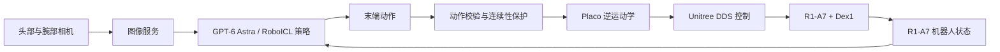

# Unitree R1-A7 GPT-6 控制

基于 [RoboICL](https://github.com/Mosi-AI/RoboICL) 的 GPT-6 Astra 视觉上下文学习策略，为 Unitree R1-A7 + Dex1 提供真机推理控制。策略读取头部与左右腕部相机画面及机器人状态，生成双臂末端动作；本地控制层负责逆运动学（IK）、动作连续性检查和 DDS 指令发布。

本仓库保留 GPT-6 推理所需的控制、相机输入和运行监视代码，不包含 VR 遥操作、示教采集工具、模型权重或 RoboICL 仿真训练环境。示教参考数据需在仓库外准备。

[演示视频](#演示) · [安装](#安装) · [运行](#运行) · [安全说明](#安全说明) · [项目结构](#项目结构)

## 演示

点击下面的预览图播放完整演示视频：

[](docs/demo/demo.mp4)

视频时长约 23 秒，展示 R1-A7 双臂将铲子和勺子放入对应盘子的推理控制过程。视频文件说明见 [docs/demo](docs/demo/README.md)。

## 系统架构



推理入口直接在本地进程运行 RoboICL 策略。相机由外部 `image_server` 提供；控制端执行 IK 和安全约束后，通过 DDS 向机器人发布命令。

## 运行前提

- Ubuntu/Linux 主机与 Unitree R1-A7 + Dex1，且主机到机器人的 Unitree DDS 网络已连通。
- 已启动 `image_server` 并提供头部及左右腕部相机画面。
- 已为当前设备准备头部相机标定文件：`robot_teleop/config/camera_calibration.yaml`。标定文件不随仓库发布，标定工具也不包含在本项目中。
- Python 3.10+、Placo、Unitree SDK2 Python，以及图像传输和 DDS 所需系统依赖。
- 实际 GPT-6 Astra 推理需要服务端认可的 `ASTRA_API_KEY`。

## 安装

```bash
git clone https://github.com/jojowwt/r1a7_gpt6.git
cd r1a7_gpt6
python3 -m venv .venv
source .venv/bin/activate
python -m pip install --upgrade pip
python -m pip install -r requirements.txt
python -m pip install -r third_party/RoboICL/setup/requirements-policy.txt
python -m pip install -e robot_teleop
```

请根据所用 Unitree SDK2 部署版本安装 `unitree-sdk2py`。Qt 控制台需要安装 `PySide6`；未安装时可使用 `--ui cv` 或 `--ui none`。

## 运行

查看全部命令行选项：

```bash
./scripts/run_r1a7_gpt6.sh --help
```

先用 `--dry-run` 检查相机、IK 和控制链路。该模式不调用模型，但仍会初始化真机通信并发布机器人控制指令。操作前确认机器人处于可控调试状态、工作空间无人且急停可立即触达：

```bash
./scripts/run_r1a7_gpt6.sh \
  --task bread_to_plate \
  --net enp5s0 \
  --dry-run \
  --ui cv
```

检查配置与运行状态后，设置 API 密钥并启动模型推理：

```bash
export ASTRA_API_KEY='YOUR_API_KEY'
./scripts/run_r1a7_gpt6.sh \
  --task bread_to_plate \
  --net enp5s0 \
  --ui qt \
  --reference /path/to/train_reference_bundle.json
```

省略 `--reference` 可运行 zero-shot rollout。使用 one-shot 示教参考时，参考包中的任务指令必须与当前任务配置完全一致，并通过本地数据完整性检查。API 密钥只从环境变量读取，不要写入配置或提交到 Git。

## 安全说明

程序会接管 R1-A7 控制并经 DDS 发布机械臂及夹爪命令。每次运行前，操作员都必须确认机器人控制模式、周边环境、急停可达性、网络接口、机器人模型、URDF、相机流和标定正确。初次部署须由操作员现场监督，并从小范围动作开始。

`--dry-run` 只跳过模型请求，不代表机器人静止或处于无运动测试状态。软件无法判断外部人员或障碍物是否进入机器人工作空间。

## 项目结构

| 路径 | 说明 |
|---|---|
| `robot_teleop/run_roboicl_live.py` | GPT-6 Astra 真机推理入口 |
| `robot_teleop/src/robot_teleop/` | R1-A7 环境、相机接入、IK、DDS 发布和运行监视 |
| `robot_teleop/config/` | R1-A7 控制参数；相机标定需按设备单独配置 |
| `assets/r1_a7/` | R1-A7 URDF 与网格模型 |
| `third_party/RoboICL/` | 推理所需 RoboICL 策略、配置及依赖源码 |
| `scripts/run_r1a7_gpt6.sh` | 推理启动脚本 |
| `docs/demo/` | 演示视频说明与资源目录 |
| `THIRD_PARTY_NOTICES.md` | 第三方组件来源及许可证说明 |

## 来源与许可证

项目保留 GPT-6 真机推理所需的 R1-A7 DDS 控制、IK、相机接入及运行监视代码；VR 遥操作和示教采集功能不在本仓库中。RoboICL 策略及必要的 XPolicyLab 图像工具位于 `third_party/RoboICL/`。第三方组件的来源和许可证见 [THIRD_PARTY_NOTICES.md](THIRD_PARTY_NOTICES.md)。根目录 MIT 许可证仅适用于本项目原创代码，不覆盖第三方文件、Unitree 机器人模型或商标。
